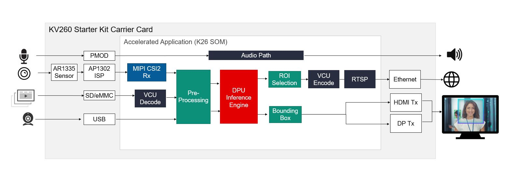

# 스마트 카메라(Smart Camera)

https://xilinx.github.io/kria-apps-docs/kv260/2022.1/build/html/docs/smartcamera/smartcamera_landing.html

스마트 카메라는 얼굴 감지 기능과 네트워크 및 디스플레이 기능을 구현합니다. 보행자 감지, 얼굴 감지, 사람 수 계산과 같은 애플리케이션을 위한 머신 러닝 기능이 내장되어 있으며, 로컬 디스플레이 출력 및 RTSP 스트리밍을 지원합니다.

  

## 개요
소개

## 주요 기능
* 센서를 통한 4K 30fps 영상 처리
* H.264/H.265 인코딩/디코딩
* HDMI, DisplayPort 또는 RTSP 출력 지원
* 사용자 프로그래밍 가능한 딥러닝 모델

## 빠른 시작(Quick Start)
* 보드 설정 및 애플리케이션 배포

## 튜토리얼
* 애플리케이션에 사용되는 AI 모델 커스터마이징
* 설계 구성 요소 빌드
* Vivado를 사용한 하드웨어 설계 빌드
* Vitis 플랫폼 생성
* 플랫폼에 오버레이(Overlay) 통합
* 사용자 지정 펌웨어 생성
* Kria 스타터 키트 리눅스(Linux) 부팅
* 애플리케이션 도커(Docker) 컨테이너 재빌드
* 새로운 센서 통합

## 아키텍처
* 소프트웨어 아키텍처 - 플랫폼
* 소프트웨어 아키텍처 - 가속기(Accelerator)
* 하드웨어 아키텍처 - 플랫폼
* 하드웨어 아키텍처 - 가속기(Accelerator)

## 저장소(Repository)
* 소프트웨어 저장소

## 기타
* 디버깅
* 알려진 문제 및 제한 사항

## 관련 튜토리얼
* Kria SOM 기반의 스마트 카메라(Smartcam) 애플리케이션 개발 예제입니다.
  * Vitis 가속기 플로우 예제 - 스마트 카메라 애플리케이션에서 DPU를 Filter2d 가속기로 교체하기
  * Vitis 플랫폼 플로우 예제 - 스마트 카메라 플랫폼에 라즈베리 파이(Raspberry Pi) 카메라 추가하기
  * 스마트 카메라용 DTSI 및 DTBO 오버레이 파일 생성
  * Vitis 가속기 플로우 예제 - 릴리스된 플랫폼상에서 스마트 카메라 애플리케이션 재빌드 (소프트웨어 개발 포함)

## AMD 지원
* 요청 사항 및 버그 추적은 GitHub 이슈(Issues)를 통해 이루어집니다. 질문이 있으시면 forums.xilinx.com을 방문해 주십시오.
