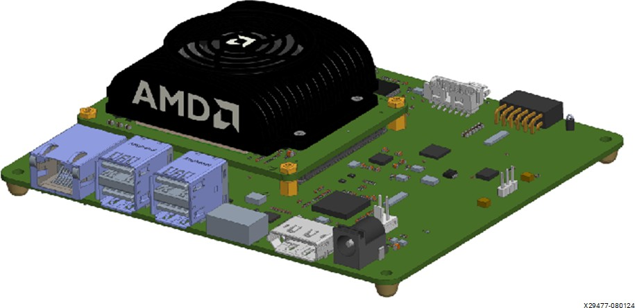
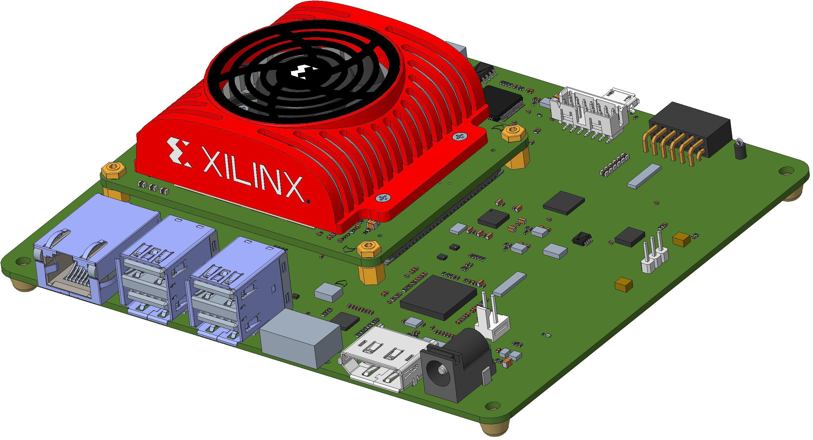
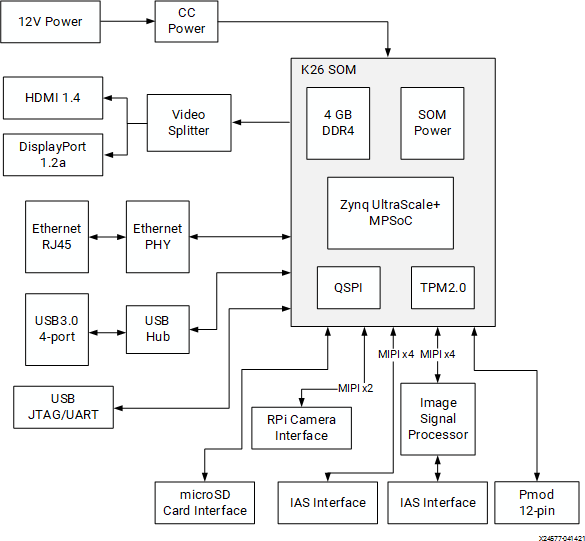
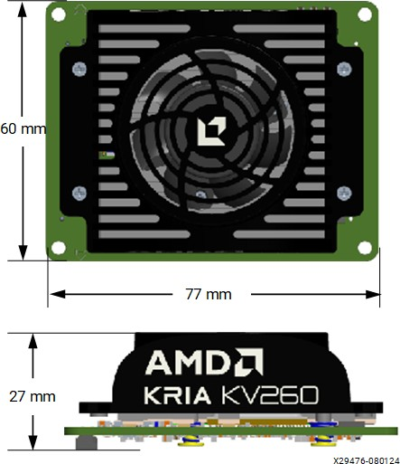
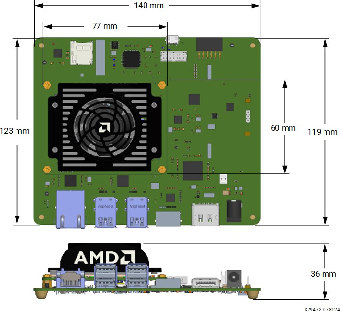
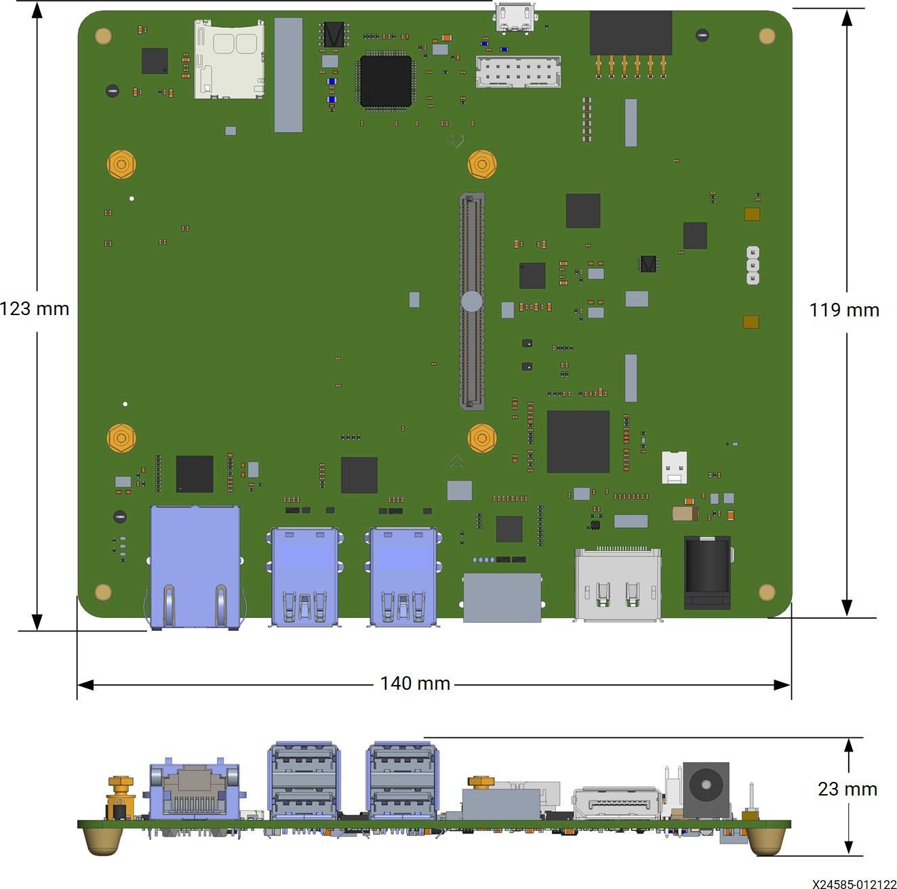
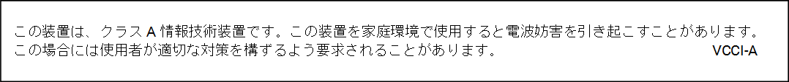
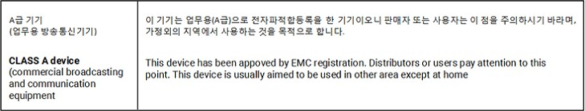
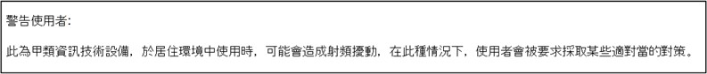

# Kria KV260 Vision AI Starter Kit Data Sheet (DS986)

# TOC
## Summary
## Product Details
* Ordering Information
## Power and Electrical
## Mechanical
## Starter Kit Firmware and Software
## Thermal
## Supported Tools
## Reliability
## Regulatory Compliance Statements
* Safety
* FCC Class A Products
* EMC Compliance
* FCC Class A User Information
* Canadian Compliance (Industry Canada)
* RoHS Compliance
* VCCI Class A Statement
* KCC Notice Class A (Republic of Korea Only)
* BSMI Class A Notice (Taiwan)
* EU WEEE Logo
* Manufacturer Declaration European Community
## References
## Revision History
## Please Read: Important Legal Notices

## Summary

The AMD Kria™ KV260 Vision AI Starter Kit is comprised of a non-production version of the K26 system-on-module (SOM), carrier card, and thermal solution. The SOM is very compact and only includes key components such as an AMD Zynq™ UltraScale+™ MPSoC based silicon device, memory, boot, and security module. The carrier card allows various interfacing options and includes a power solution and network connectors for camera, display, and microSD card. The thermal solution has a heat sink, heat sink cover, and fan. The Kria KV260 Vision AI Starter Kit is designed to provide customers a platform to evaluate their target applications  and ultimately design their own carrier card with AMD K26
SOMs.   While the SOM itself has broad AI/ML applicability across markets and applications, target applications for the Kria KV260 Vision AI Starter Kit include smart city and machine vision, security cameras, retail analytics,
and other industrial applications.

There are two versions of the KV260 carrier card (rev. 1.0 and rev. 2.0). Some of the features are only available on the 2.0 version. For further details, refer Kria KV260 Vision AI Starter Kit User Guide (UG1089) and to the schematics of each version.

Figure: Kria KV260 Vision AI Starter Kit Revision 2.0

  

Figure: Kria KV260 Vision AI Starter Kit Revision 1.0

  

## Product Details

The Kria KV260 Vision AI Starter Kit is an evaluation platform for the K26 SOM focused on machine learning (ML) acceleration in vision applications. The kit brings together a Zynq UltraScale+ MPSoC based SOM with user selectable, vision focused peripherals and a set of pre-built accelerated applications. The KV260 and its base K26 SOM are supported for full user customization through AMD Vitis™ platforms, customizable acceleration overlays,  and AMD Vivado™ tools hardware board files. The integrated combination of hardware, platform, and software provides a quick out-of-box experience for developers that can then be leveraged for product designs.

> ✎ Note: The SOM on the Kria KV260 Vision AI Starter Kit does not populate the eMMC.

Figure: KV260 Starter Kit Block Diagram

  

Table: Kria KV260 Vision AI Starter Kit Product Details

| Specification | Description | 
|:----------------:|:----------------:|
| Thermal cooling solution | Active | 
| Weight | 205g | 
| Form factor | SOM + Carrier Card | 
| Dimensions of the KV260 Starter Kit | 123 mm x 140 mm x 36 mm | 
| Dimensions of the SOM with thermal solution | 60 mm x 77 mm x 27 mm | 
| Dimensions of the carrier card | 123 mm x 140 mm x 23 mm | 
| System logic cells | 256K | 
| Block RAM blocks | 144 | 
| UltraRAM blocks | 64 | 
| DSP slices | 1.2K | 
| Ethernet interface | One 10/100/1000 Mb/s | 
| DDR memory | 4 GB (4 x 512 Mb x 16 bit) [non-ECC] DDR4 | 
| Primary boot memory | 512 Mb QSPI | 
| Secondary boot memory | microSD card | 
| Device Security | Zynq UltraScale+ MPSoC hardware root of trust (RoT) in support of secure boot. Infineon TPM2.0 in support of measured boot. | 
| Image sensor processor | OnSemi AP1302 13MP ISP | 
| IAS MIPI sensor interfaces | x2 |
| Raspberry Pi camera interface | x1 |
| PMOD 12-pin interface | x1 |
| USB3.0 interface | x4 |
| DisplayPort 1.2a | x1 |
| HDMI 1.4 | x1 |

## Ordering Information

Table: Ordering Information

| Product SKU  |  Device  |  Temperature Grade | Encryption |  Description | 
|:----------------:|:----------------:|:----------------:|:----------------:|:----------------:|
| SK-KV260-G | XCK26-C | Commercial | Enabled | KV260 Starter Kit with encryption enabled | 
| SK-KV260-G-ED* | XCK26-C | Commercial | Disabled* | KV260 Starter Kit with encryption disabled | 

* Encryption disabled (-ED) versions of the KV260 Starter Kit are discontinued.

## Power and Electrical

This section describes the power requirements, power-on sequence, power-on reset sequence, and power management functions.

Table: KV260 Starter Kit Power Specifications

| Parameter | Description | 
|:----------------:|:----------------:|
| DC input power |  +12V, 3A | 
| Recommended power adapter | The CUI Inc. SMI36-12-V-P6 adapter connected using a center-pin positive barrel connector (2.5mm ID, 5.5 mm OD) | 
| SOM supply | +5V, 3A (VCC_SOM) | 
| SOM power telemetry | Current sense device (INA260) is available through the I2C bus address 0x40 to monitor the current on the VCC_SOM power rail. Refer to the Kria KV260 Vision AI Starter Kit User Guide (UG1089) for the platformstats application that is provided in the AMD pre-built images to read this information. | 
| USB 3.0 | 5V, 900 mA per port (limited to 2.1A total) | 
| Pmod interface from Digilent Inc.  |  3.3V, 100 mA | 
| Raspberry Pi camera interface   |   3.3V | 
| ON Semiconductor IAS module connector 0 | 2.75V, 1.8V, 1.2V | 
| ON Semiconductor IAS module connector 1 | 2.75V, 1.8V, 1.2V | 

# KV260 Starter Kit Power On Sequence

1. External power adapter supplies 12V power

2. On-board regulator generates 5V supply and provides power to other voltage regulators

3. SOM power rail (VCC_SOM) is powered by a 5V supply

4. When the 5V regulator output voltage level is within the specified range and a power-good signal is asserted and the POWER_OFF_C2M_L signal is deasserted by the carrier card

5. SOM on board power on sequencing starts

6. Carrier card provides PS and PL VCCO voltage rails after the SOM asserts the VCCOEN_PS_M2C and VCCOEN_PL_M2C signals

# KV260 Starter Kit Power On Reset

1. The SOM reset signal ( PS_POR_L ) is held in reset until the PS_PGOOD signal is asserted.

2. To perform a hard reset on the SOM, use the reset push-button on the carrier card to assert the PS_POR_L signal.

3. All the PS and PL I/O device reset signals on the carrier card are held in reset until 25 ms after the PS and PL power domain are powered up and stable.

# Mechanical

This section outlines the mechanical specifications of the Kria KV260 Vision AI Starter Kit. The KV260 revision 1 and KV260 revision 2 have identical mechanical measurements.

Table: Kria KV260 Vision AI Starter Kit Mechanical Details

| Specification |  Dimensions | 
| Dimensions of the KV260 Starter Kit | 123 mm x 140 mm x 36 mm | 
| Dimensions of the SOM with thermal solution | 60 mm x 77 mm x 27 mm | 
| Dimensions of the carrier card | 123 mm x 140 mm x 23 mm | 

Figure: K26 SOM on the Kria KV260 Vision AI Starter Kit Mechanical Dimensions

  

Figure: Kria KV260 Vision AI Starter Kit Mechanical Dimensions

  

Figure: Kria KV260 Vision AI Starter Kit Carrier Card Mechanical Dimensions

  

# Starter Kit Firmware and Software

The KV260 Starter Kit is preloaded at the time of manufacturing with a supporting set of boot and platform recovery firmware. The boot firmware is maintained in the QSPI non-volatile memory device and the carrier card fixes the Zynq UltraScale+ MPSoC boot mode to QSPI32. The operating system (OS) and application software are managed in the microSD card secondary boot device. Linux is the default OS for the AMD example applications. A pre-built Linux image is provided for the KV260 Starter Kit on the Kria SOM Wiki.

# Thermal

## Operating and Storage Temperature Conditions

Table: Operating and Storage Temperatures and Humidity Condition

| Specification | Condition | 
| Operating temperature | 0°C to 35°C * | 
| Storage temperature   | 0°C to 70°C | 
| Operating humidity, non-condensing | 8% to 90%, and a dew point of – 12°C | 
| Storage humidity, non-condensing  |  5% to 95% | 

*. The Kria KV260 Vision AI Starter Kit is for evaluation purposes only. The operating temperature range is not fully tested, it is a general guideline. Use the Kria KV260 Vision AI Starter Kit in a typical lab environment. Do not operate beyond room temperature.

## KV260 Starter Kit Cooling Solution

The KV260 Starter Kit uses an active cooling solution to support the maximum thermal power dissipation of 15W.

# Supported Tools

The Kria KV260 Vision AI Starter Kitis enabled in the AMD Vivado and AMD Vitis™ tools. For details on getting started with the kit see Kria KV260 Vision AI Starter Kit User Guide (UG1089).

# Reliability

The Kria SOM Starter Kits are not designed or qualified for production use. The kits undergo a basic level of testing and reliability and should pass all the certification requirements necessary for evaluation kit purposes (for example RoHS and CE). To develop and deploy a production quality product based upon this starter kit, design your own (compatible) carrier cards and test them to the appropriate and required certification standards for your end application. By purchasing the K26 SOM (available in commercial (C) or industrial (I) temperature grades) and designing your own (compatible) carrier  card, you leverage the advantages of the K26 SOM in your end application.

# Regulatory Compliance Statements

## Safety

The following safety standards apply to all products listed in this document.

IEC 62368-1, 2nd Edition, 2014/A11:2017, Information technology equipment – Safety, Part 1: General requirements

EN 62368-1, 2nd Edition, 2014/A11:2017, Information technology equipment – Safety, Part 1: General requirements

## FCC Class A Products

The following is a list of the products covered by this data sheet:

* SK-KV260-G
* SK-KV260-G-ED

Regulatory Compliance Statements are valid for the production version of the K26 SOM; not for ES boards and the non-production SOM on the KV260 Starter Kit .

## Safety Compliance

The following safety standards apply to all products listed above.

* UL 62368-1, 2nd Edition, 2014/A11:2017 (Information Technology Equipment - Safety - Part 1: General Requirements)
* CSA C22.2 No. 60950-1-07, 2nd Edition, 2014/A11:2017 (Information Technology Equipment - Safety - Part 1: General Requirements)
* EU LVD Directive 2014/35/EU
* EN/IEC-62368-12014/A11:2017

# EMC Compliance

## Class A Products

The following standards apply:

* FCC Part 15 – Radiated & Conducted Emissions (USA)
* CAN ICES-3(A)/NMB-3(A) – Radiated & Conducted Emissions (Canada)
* CISPR 32 – Radiated & Conducted Emissions (International)
* EN55032: 2015 – Radiated & Conducted Emissions (European Union)
* EN55035:2017 – Immunity (European Union)
* EMC Directive 2014/30/EU
* VCCI (Class A)– Radiated & Conducted Emissions (Japan)
* CNS 15663 - RoHS (Taiwan)
* AS/NZS CISPR 32 – Radiated and Conducted Emissions (Australia/New Zealand)
* Article 58-2 of Radio Waves Act, Clause 3 (Korea)

# Regulatory Compliance Markings

When required, these products are provided with the following product certification markings:

* UL Listed Accessories Mark for the USA and Canada
* CE mark
* UKCA mark
* FCC markings
* VCCI marking
* Australian RCM mark
* Korea MSIP mark
* Taiwan BSMI mark

# FCC Class A User Information

The Class A products listed above comply with Part 15 of the FCC Rules. Operation is subject to the following two conditions:

1. This device may not cause harmful interference.

2. This device must accept any interference received, including interference that may cause undesired operation.

> ⚠ CAUTION!
> This equipment has been tested and found to comply with the limits for a Class A digital device, pursuant to Part 15 of the FCC rules. These limits are designed to provide reasonable protection against harmful interference when the
equipment    is operated in a commercial environment. This equipment generates, uses, and can radiate radio frequency energy and, if not installed and used in accordance with the instructions, may cause harmful interference to radio communications. Operation of this equipment in a residential area is likely to cause harmful interference, in  which case the user will be required to correct the interference at their own expense.

> ⚠ CAUTION!
> Cet équipement a été testé et jugé conforme à la Class A digital device, conformément à la règle 15 du standard FCC. Ces limites sont conçues pour fournir des protections contre des interférences nuisibles lorsque l'équipement est utilisé dans un environnement commercial. Cet équipement génère, utilise et peut émettre des énergies de radio-fréquence et, s'il n'est pas installé et utilisé conformément aux instructions, peut nuire aux communications radio. L'exploitation de cet équipement dans une zone résidentielle est susceptible de causer des interférences nuisibles, auquel cas l'utilisateur peut être tenu de prendre des mesures adéquates à ses propres frais.

> ⚠ CAUTION!
> Dieses Gerät wurde getestet und entspricht den Grenzwerten für digitale Geräte der Klasse A gemäß Teil 15 der FCC-Bestimmungen. Diese Grenzwerte bieten einen angemessenen Schutz gegen schädliche Interferenzen, wenn das Gerät     in einer gewerblichen Umgebung betrieben wird. Dieses Gerät erzeugt und verwendet Hochfrequenzenergie und kann diese abstrahlen. Wenn es nicht gemäß den Anweisungen installiert und verwendet wird, kann dies Funkstörungen verursachen. Der Betrieb dieses Geräts in einem Wohngebiet kann schädliche Interferenzen verursachen. In diesem Fall muss der Benutzer die Interferenz auf eigene Kosten beheben.

> ⚠ CAUTION!
> If the device is changed or modified without permission from AMD, the user may void their authority to operate the equipment.

> ⚠ CAUTION!
> Si l'appareil est modifié sans l'autorisation d'AMD, l'utilisateur peut annuler son abilité à utiliser l'équipement.

> ⚠ CAUTION!
> Wenn das Gerät ohne Erlaubnis von AMD geändert wird, kann der Benutzer seine Berechtigung zum Betrieb des Geräts verlieren.

# Canadian Compliance (Industry Canada)

CAN ICES-3(A)/NMB-3(A)

# RoHS Compliance

* RoHS Directive 2011/65/EU
* RoHS 3 Directive 2015/863
* SJ/T 11363-2006, 11364-2006, and GB/T 26572-2011 (China RoHS)

# VCCI Class A Statement

  

# KCC Notice Class A (Republic of Korea Only)

  

# BSMI Class A Notice (Taiwan)

  

# EU WEEE Logo

  

# Manufacturer Declaration European Community

  

  

## Manufacturer Declaration

Xilinx declares that the equipment described in this document is in conformance with the requirements of the European Council Directives listed below:

* Low Voltage Directive 2014/35/EU
* EMC Directive 2014/30/EU
* RoHS 3 Directive 2011/65/EU, 2015/863
* China RoHS Declaration: Standards SJ/T 11363-2006, 11364-2006, and GB/T 26572-2011
* REACH Regulation 1907/2006
* POP Regulation 2019/1021

These products follow the provisions of the European Directive 2014/53/EU.

Dette produkt er i overensstemmelse med det europæiske direktiv 2014/53/EU.

Dit product is in navolging van de bepalingen van Europees Directief 2014/53/EU.

Tämä tuote noudattaa EU-direktiivin 2014/53/EU määräyksiä.

Ce produit est conforme aux exigences de la Directive Européenne 2014/53/EU.

Dieses Produkt entspricht den Bestimmungen der Europäischen Richtlinie 2014/53/EU.

Þessi vara stenst reglugerð Evrópska Efnahags Bandalagsins númer 2014/53/EU.

Questo prodotto è conforme alla Direttiva Europea 2014/53/EU.

Dette produktet er i henhold til bestemmelsene i det europeiske direktivet 2014/53/EU.

Este produto cumpre com as normas da Diretiva Européia 2014/53/EU.

Este producto cumple con las normas del Directivo Europeo 2014/53/EU.

Denna produkt har tillverkats i enlighet med EG-direktiv 2014/53/EU.

* EN 55032 (CISPR 32 Class A) RF Emissions Control
* EN 55035:2017 (CISPR 35) Electromagnetic compatibility of multimedia equipment – Immunity requirements
* EN 62368-1, 2nd Edition, 2014/A11:2017 Information technology equipment – Safety, Part 1: General Requirements
* EN 50581:2012 - Technical documentation for the assessment of electrical and electronic products with respect to the restriction of hazardous substances.

> ⚠ CAUTION!
> In a domestic environment, Class A products could cause radio interference, in which case the user may be required to take adequate measures.

> ⚠ CAUTION!
> Dans un environnement domestique, les produits de Classe A peuvent causer des interférences radio, auquel cas l'utilisateur peut être tenu de prendre des mesures adéquates.

> ⚠ CAUTION!
> In einer häuslichen Umgebung können Produkte der Klasse A Funkstörungen verursachen. In diesem Fall muss der Benutzer möglicherweise geeignete Maßnahmen ergreifen.

## Responsible Party

* Xilinx, Inc.
* 2100 Logic Drive, San Jose, CA 95124
* United States of America
* Phone: (408) 559-7778

# References

These documents provide supplemental material useful with this guide:

1. Kria KV260 Vision AI Starter Kit User Guide (UG1089)

2. Kria K26 SOM Data Sheet (DS987)

3. Kria K26 SOM Thermal Design Guide (UG1090)

4. Kria SOM Carrier Card Design Guide (UG1091)

