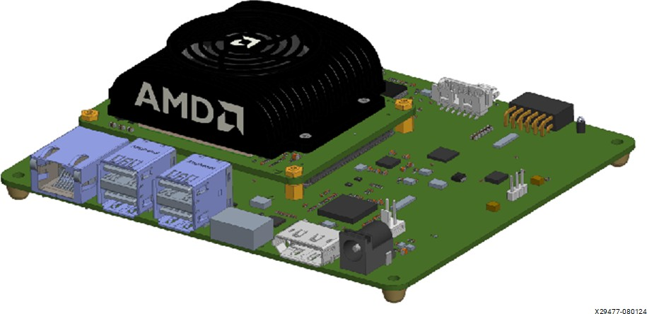
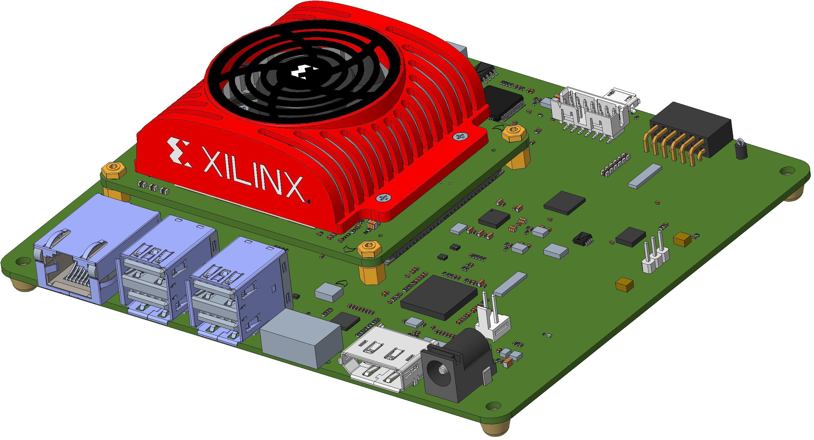
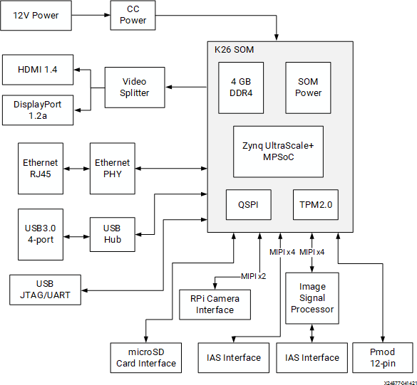
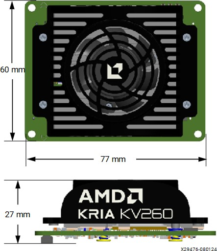
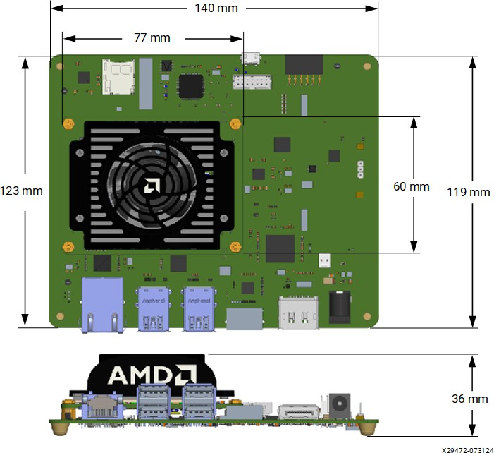
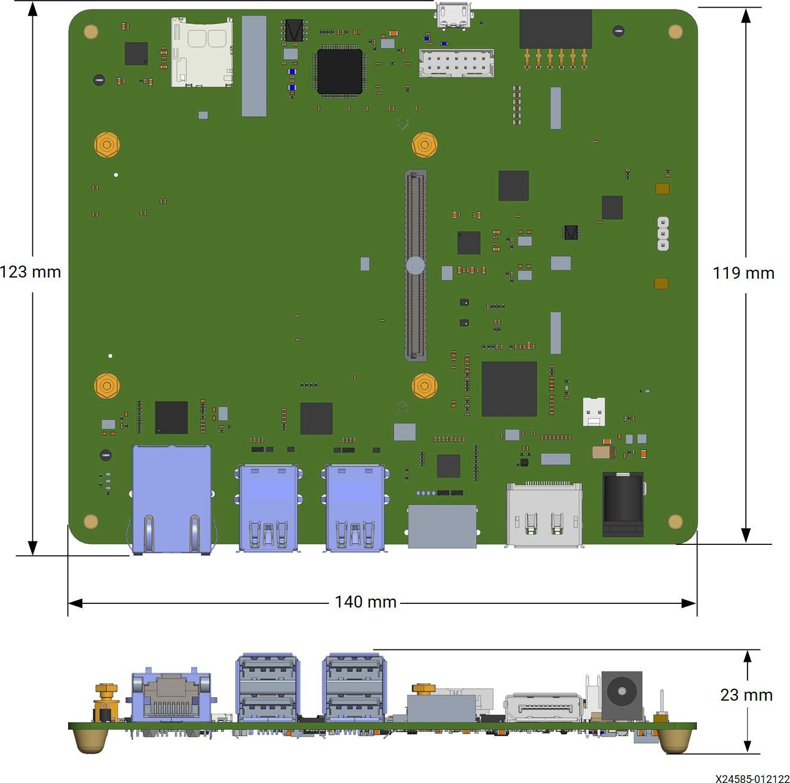
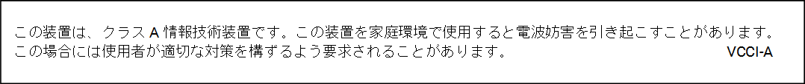
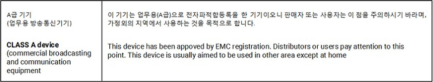
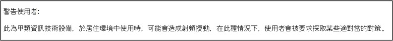
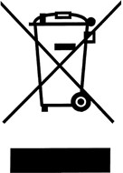

# Kria KV260 Vision AI 스타터 키트 데이터 시트 (DS986)

https://docs.amd.com/r/en-US/ds986-kv260-starter-kit/Summary

# 목차
## 요약
## 제품 세부 정보
* 주문 정보
## 전원 및 전기
## 기계
## 스타터 키트 펌웨어 및 소프트웨어
## 열
## 지원 도구
## 신뢰성
## 규정 준수 성명
* 안전
* FCC 클래스 A 제품
* EMC 준수
* FCC 클래스 A 사용자 정보
* 캐나다 준수 (산업부)
* RoHS 준수
* VCCI 클래스 A 성명
* KCC 고지 클래스 A (대한민국에 한함)
* BSMI 클래스 A 고지 (대만)
* EU WEEE 로고
* 유럽 공동체 제조사 선언
## 참고 문헌
## 개정 이력
## 필독: 중요 법적 고지 사항

## 요약

AMD Kria™ KV260 Vision AI 스타터 키트는 비양산 버전의 K26 시스템 온 모듈(SOM), 캐리어 카드 및 열 솔루션으로 구성됩니다. SOM은 매우 컴팩트하며 AMD Zynq™ UltraScale+™ MPSoC 기반 실리콘 디바이스, 메모리, 부팅 및 보안 모듈과 같은 핵심 구성 요소만 포함합니다. 캐리어 카드는 다양한 인터페이스 옵션을 허용하며 카메라, 디스플레이 및 microSD 카드용 전원 솔루션과 네트워크 커넥터를 포함합니다. 열 솔루션은 히트 싱크, 히트 싱크 커버 및 팬으로 구성됩니다. Kria KV260 Vision AI 스타터 키트는 고객이 목표 애플리케이션을 평가하고 궁극적으로 AMD K26 SOM을 사용하여 자체 캐리어 카드를 설계할 수 있는 플랫폼을 제공하도록 설계되었습니다. SOM 자체는 시장과 애플리케이션 전반에 걸쳐 폭넓은 AI/ML 적용 가능성을 가지지만, Kria KV260 Vision AI 스타터 키트의 목표 애플리케이션에는 스마트 시티 및 머신 비전, 보안 카메라, 리테일 분석 및 기타 산업용 애플리케이션이 포함됩니다.

KV260 캐리어 카드에는 두 가지 버전(rev. 1.0 및 rev. 2.0)이 있습니다. 일부 기능은 2.0 버전에서만 사용할 수 있습니다. 자세한 내용은 Kria KV260 Vision AI 스타터 키트 사용자 가이드(UG1089) 및 각 버전의 회로도를 참조하십시오.

그림: Kria KV260 Vision AI 스타터 키트 개정 2.0

  

그림: Kria KV260 Vision AI 스타터 키트 개정 1.0

  

## 제품 세부 정보

Kria KV260 Vision AI 스타터 키트는 비전 애플리케이션의 머신러닝(ML) 가속에 초점을 맞춘 K26 SOM용 평가 플랫폼입니다. 이 키트는 Zynq UltraScale+ MPSoC 기반 SOM을 사용자가 선택할 수 있는 비전 중심 주변 장치 및 사전 구축된 가속 애플리케이션 세트와 결합합니다. KV260과 기본 K26 SOM은 AMD Vitis™ 플랫폼, 사용자 정의 가능한 가속 오버레이 및 AMD Vivado™ 도구 하드웨어 보드 파일을 통해 완전한 사용자 맞춤화를 지원합니다. 하드웨어, 플랫폼 및 소프트웨어의 통합된 조합은 개발자에게 즉시 사용 가능한 빠른 경험을 제공하며, 이를 제품 설계에 활용할 수 있습니다.

> ✎ 참고: Kria KV260 Vision AI 스타터 키트의 SOM에는 eMMC가 장착되어 있지 않습니다.

그림: KV260 스타터 키트 블록 다이어그램

  

표: Kria KV260 Vision AI 스타터 키트 제품 세부 정보

| 사양 | 설명 | 
|:----------------:|:----------------:|
| 열 냉각 솔루션 | 능동 | 
| 무게 | 205g | 
| 폼 팩터 | SOM + 캐리어 카드 | 
| KV260 스타터 키트 치수 | 123 mm x 140 mm x 36 mm | 
| 열 솔루션이 포함된 SOM 치수 | 60 mm x 77 mm x 27 mm | 
| 캐리어 카드 치수 | 123 mm x 140 mm x 23 mm | 
| 시스템 로직 셀 | 256K | 
| 블록 RAM 블록 | 144 | 
| UltraRAM 블록 | 64 | 
| DSP 슬라이스 | 1.2K | 
| 이더넷 인터페이스 | 10/100/1000 Mb/s 1개 | 
| DDR 메모리 | 4 GB (4 x 512 Mb x 16 bit) [비 ECC] DDR4 | 
| 기본 부팅 메모리 | 512 Mb QSPI | 
| 보조 부팅 메모리 | microSD 카드 | 
| 디바이스 보안 | 보안 부팅을 지원하는 Zynq UltraScale+ MPSoC 하드웨어 신뢰 루트(RoT). 측정 부팅을 지원하는 Infineon TPM2.0. | 
| 이미지 센서 프로세서 | OnSemi AP1302 13MP ISP | 
| IAS MIPI 센서 인터페이스 | x2 | 
| 라즈베리 파이 카메라 인터페이스 | x1 | 
| PMOD 12핀 인터페이스 | x1 | 
| USB3.0 인터페이스 | x4 | 
| DisplayPort 1.2a | x1 | 
| HDMI 1.4 | x1 | 

## 주문 정보

표: 주문 정보

| 제품 SKU | 디바이스 | 온도 등급 | 암호화 | 설명 | 
|:----------------:|:----------------:|:----------------:|:----------------:|:----------------:|
| SK-KV260-G | XCK26-C | 상용 | 활성화 | 암호화가 활성화된 KV260 스타터 키트 | 
| SK-KV260-G-ED* | XCK26-C | 상용 | 비활성화* | 암호화가 비활성화된 KV260 스타터 키트 | 

* 암호화가 비활성화된(-ED) KV260 스타터 키트 버전은 단종되었습니다.

## 전원 및 전기

이 섹션에서는 전원 요구 사항, 전원 켜기 시퀀스, 전원 켜기 리셋 시퀀스 및 전원 관리 기능을 설명합니다.

표: KV260 스타터 키트 전원 사양

| 매개변수 | 설명 | 
|:----------------:|:----------------:|
| DC 입력 전원 | +12V, 3A | 
| 권장 전원 어댑터 | 센터 핀 양극 배럴 커넥터(2.5mm ID, 5.5 mm OD)를 사용하여 연결된 CUI Inc. SMI36-12-V-P6 어댑터 | 
| SOM 공급 전원 | +5V, 3A (VCC_SOM) | 
| SOM 전력 텔레메트리 | 전류 감지 디바이스(INA260)를 I2C 버스 주소 0x40을 통해 사용하여 VCC_SOM 전원 레일의 전류를 모니터링할 수 있습니다. 이 정보를 읽는 데 AMD 사전 빌드 이미지에 제공되는 platformstats 애플리케이션에 대해서는 Kria KV260 Vision AI 스타터 키트 사용자 가이드(UG1089)를 참조하십시오. | 
| USB 3.0 | 포트당 5V, 900 mA (총 2.1A로 제한) | 
| Digilent Inc.의 Pmod 인터페이스 | 3.3V, 100 mA | 
| 라즈베리 파이 카메라 인터페이스 | 3.3V | 
| ON Semiconductor IAS 모듈 커넥터 0 | 2.75V, 1.8V, 1.2V | 
| ON Semiconductor IAS 모듈 커넥터 1 | 2.75V, 1.8V, 1.2V | 

# KV260 스타터 키트 전원 켜기 시퀀스

1. 외부 전원 어댑터가 12V 전원을 공급합니다.

2. 온보드 레귤레이터가 5V 공급 전원을 생성하고 다른 전압 레귤레이터에 전원을 제공합니다.

3. SOM 전원 레일(VCC_SOM)은 5V 공급 전원으로부터 전력을 공급받습니다.

4. 5V 레귤레이터 출력 전압 레벨이 지정된 범위 내에 있고 전원 양호(power-good) 신호가 어서트되며 캐리어 카드에 의해 POWER_OFF_C2M_L 신호가 디어서트될 때

5. SOM 온보드 전원 켜기 시퀀싱이 시작됩니다.

6. SOM이 VCCOEN_PS_M2C 및 VCCOEN_PL_M2C 신호를 어서트한 후 캐리어 카드가 PS 및 PL VCCO 전압 레일을 제공합니다.

# KV260 스타터 키트 전원 켜기 리셋

1. SOM 리셋 신호(PS_POR_L)는 PS_PGOOD 신호가 어서트될 때까지 리셋 상태로 유지됩니다.

2. SOM에서 하드 리셋을 수행하려면 캐리어 카드의 리셋 푸시 버튼을 사용하여 PS_POR_L 신호를 어서트하십시오.

3. 캐리어 카드의 모든 PS 및 PL I/O 디바이스 리셋 신호는 PS 및 PL 전원 도메인이 전원이 공급되고 안정화된 후 25ms까지 리셋 상태로 유지됩니다.

# 기계

이 섹션에서는 Kria KV260 Vision AI 스타터 키트의 기계적 사양을 설명합니다. KV260 개정 1과 KV260 개정 2는 동일한 기계적 치수를 가집니다.

표: Kria KV260 Vision AI 스타터 키트 기계 세부 정보

| 사양 | 치수 | 
| KV260 스타터 키트 치수 | 123 mm x 140 mm x 36 mm | 
| 열 솔루션이 포함된 SOM 치수 | 60 mm x 77 mm x 27 mm | 
| 캐리어 카드 치수 | 123 mm x 140 mm x 23 mm | 

그림: Kria KV260 Vision AI 스타터 키트의 K26 SOM 기계 치수

  

그림: Kria KV260 Vision AI 스타터 키트 기계 치수

  

그림: Kria KV260 Vision AI 스타터 키트 캐리어 카드 기계 치수

  

# 스타터 키트 펌웨어 및 소프트웨어

KV260 스타터 키트는 제조 시 지원되는 부팅 및 플랫폼 복구 펌웨어 세트가 사전 로드되어 있습니다. 부팅 펌웨어는 QSPI 비휘발성 메모리 디바이스에 유지되며 캐리어 카드는 Zynq UltraScale+ MPSoC 부팅 모드를 QSPI32로 고정합니다. 운영 체제(OS) 및 애플리케이션 소프트웨어는 microSD 카드 보조 부팅 디바이스에서 관리됩니다. Linux는 AMD 예제 애플리케이션의 기본 OS입니다. 사전 빌드된 Linux 이미지는 Kria SOM 위키에서 KV260 스타터 키트용으로 제공됩니다.

# 열

## 작동 및 보관 온도 조건

표: 작동 및 보관 온도와 습도 조건

| 사양 | 조건 | 
| 작동 온도 | 0°C ~ 35°C * | 
| 보관 온도 | 0°C ~ 70°C | 
| 작동 습도, 비응축 | 8% ~ 90%, 이슬점 –12°C | 
| 보관 습도, 비응축 | 5% ~ 95% | 

*. Kria KV260 Vision AI 스타터 키트는 평가 목적으로만 사용됩니다. 작동 온도 범위는 완전히 테스트되지 않았으며 일반적인 지침입니다. Kria KV260 Vision AI 스타터 키트는 일반적인 실험실 환경에서 사용하십시오. 실온을 초과하여 작동하지 마십시오.

## KV260 스타터 키트 냉각 솔루션

KV260 스타터 키트는 최대 열 소산 전력 15W를 지원하기 위해 능동 냉각 솔루션을 사용합니다.

# 지원 도구

Kria KV260 Vision AI 스타터 키트는 AMD Vivado 및 AMD Vitis™ 도구에서 지원됩니다. 키트 시작에 대한 자세한 내용은 Kria KV260 Vision AI 스타터 키트 사용자 가이드(UG1089)를 참조하십시오.

# 신뢰성

Kria SOM 스타터 키트는 양산 사용을 위해 설계되거나 인증되지 않았습니다. 키트는 기본 수준의 테스트와 신뢰성을 거치며 평가 키트 목적에 필요한 모든 인증 요구 사항(예: RoHS 및 CE)을 통과해야 합니다. 이 스타터 키트를 기반으로 양산 품질 제품을 개발 및 배포하려면 자체 (호환) 캐리어 카드를 설계하고 최종 애플리케이션에 적합하고 요구되는 인증 표준에 따라 테스트하십시오. K26 SOM(상용(C) 또는 산업용(I) 온도 등급으로 제공)을 구매하고 자체 (호환) 캐리어 카드를 설계함으로써 최종 애플리케이션에서 K26 SOM의 장점을 활용할 수 있습니다.

# 규정 준수 성명

## 안전

다음 안전 표준은 이 문서에 나열된 모든 제품에 적용됩니다.

IEC 62368-1, 2판, 2014/A11:2017, 정보 기술 장비 – 안전, 파트 1: 일반 요구 사항

EN 62368-1, 2판, 2014/A11:2017, 정보 기술 장비 – 안전, 파트 1: 일반 요구 사항

## FCC 클래스 A 제품

다음은 이 데이터 시트의 적용을 받는 제품 목록입니다:

* SK-KV260-G
* SK-KV260-G-ED

규정 준수 성명은 K26 SOM의 양산 버전에 유효하며, ES 보드 및 KV260 스타터 키트의 비양산 SOM에는 유효하지 않습니다.

## 안전 준수

다음 안전 표준은 위에 나열된 모든 제품에 적용됩니다.

* UL 62368-1, 2판, 2014/A11:2017 (정보 기술 장비 - 안전 - 파트 1: 일반 요구 사항)
* CSA C22.2 No. 60950-1-07, 2판, 2014/A11:2017 (정보 기술 장비 - 안전 - 파트 1: 일반 요구 사항)
* EU LVD 지침 2014/35/EU
* EN/IEC-62368-12014/A11:2017

# EMC 준수

## 클래스 A 제품

다음 표준이 적용됩니다:

* FCC Part 15 – 방사 및 전도 방출 (미국)
* CAN ICES-3(A)/NMB-3(A) – 방사 및 전도 방출 (캐나다)
* CISPR 32 – 방사 및 전도 방출 (국제)
* EN55032: 2015 – 방사 및 전도 방출 (유럽 연합)
* EN55035:2017 – 내성 (유럽 연합)
* EMC 지침 2014/30/EU
* VCCI (클래스 A) – 방사 및 전도 방출 (일본)
* CNS 15663 - RoHS (대만)
* AS/NZS CISPR 32 – 방사 및 전도 방출 (호주/뉴질랜드)
* 전파법 제58-2조 제3항 (한국)

# 규정 준수 마킹

필요한 경우, 이 제품에는 다음과 같은 제품 인증 마킹이 제공됩니다:

* 미국 및 캐나다용 UL 등록 액세서리 마크
* CE 마크
* UKCA 마크
* FCC 마킹
* VCCI 마킹
* 호주 RCM 마크
* 한국 MSIP 마크
* 대만 BSMI 마크

# FCC 클래스 A 사용자 정보

위에 나열된 클래스 A 제품은 FCC 규칙 Part 15를 준수합니다. 작동에는 다음 두 가지 조건이 적용됩니다:

1. 이 디바이스는 유해한 간섭을 일으키지 않아야 합니다.

2. 이 디바이스는 원치 않는 작동을 유발할 수 있는 간섭을 포함하여 수신되는 모든 간섭을 수용해야 합니다.

> ⚠ 주의!
> 이 장비는 FCC 규칙 Part 15에 따라 클래스 A 디지털 디바이스의 제한을 준수하는 것으로 테스트되고 확인되었습니다. 이러한 제한은 장비가 상업적 환경에서 작동될 때 유해한 간섭에 대해 합리적인 보호를 제공하도록 설계되었습니다. 이 장비는 무선 주파수 에너지를 생성, 사용 및 방출할 수 있으며, 지침에 따라 설치 및 사용하지 않을 경우 무선 통신에 유해한 간섭을 일으킬 수 있습니다. 주거 지역에서 이 장비를 작동하면 유해한 간섭을 일으킬 가능성이 있으며, 이 경우 사용자는 자비로 간섭을 수정해야 합니다.

> ⚠ 주의!
> Cet équipement a été testé et jugé conforme à la Class A digital device, conformément à la règle 15 du standard FCC. Ces limites sont conçues pour fournir des protections contre des interférences nuisibles lorsque l'équipement est utilisé dans un environnement commercial. Cet équipement génère, utilise et peut émettre des énergies de radio-fréquence et, s'il n'est pas installé et utilisé conformément aux instructions, peut nuire aux communications radio. L'exploitation de cet équipement dans une zone résidentielle est susceptible de causer des interférences nuisibles, auquel cas l'utilisateur peut être tenu de prendre des mesures adéquates à ses propres frais.

> ⚠ 주의!
> Dieses Gerät wurde getestet und entspricht den Grenzwerten für digitale Geräte der Klasse A gemäß Teil 15 der FCC-Bestimmungen. Diese Grenzwerte bieten einen angemessenen Schutz gegen schädliche Interferenzen, wenn das Gerät in einer gewerblichen Umgebung betrieben wird. Dieses Gerät erzeugt und verwendet Hochfrequenzenergie und kann diese abstrahlen. Wenn es nicht gemäß den Anweisungen installiert und verwendet wird, kann dies Funkstörungen verursachen. Der Betrieb dieses Geräts in einem Wohngebiet kann schädliche Interferenzen verursachen. In diesem Fall muss der Benutzer die Interferenz auf eigene Kosten beheben.

> ⚠ 주의!
> AMD의 허가 없이 디바이스를 변경하거나 수정하면 사용자의 장비 작동 권한이 무효화될 수 있습니다.

> ⚠ 주의!
> Si l'appareil est modifié sans l'autorisation d'AMD, l'utilisateur peut annuler son abilité à utiliser l'équipement.

> ⚠ 주의!
> Wenn das Gerät ohne Erlaubnis von AMD geändert wird, kann der Benutzer seine Berechtigung zum Betrieb des Geräts verlieren.

# 캐나다 준수 (산업부)

CAN ICES-3(A)/NMB-3(A)

# RoHS 준수

* RoHS 지침 2011/65/EU
* RoHS 3 지침 2015/863
* SJ/T 11363-2006, 11364-2006 및 GB/T 26572-2011 (중국 RoHS)

# VCCI 클래스 A 성명

  

# KCC 고지 클래스 A (대한민국에 한함)

  

# BSMI 클래스 A 고지 (대만)

  

# EU WEEE 로고

  

# 유럽 공동체 제조사 선언

  

  

## 제조사 선언

Xilinx는 이 문서에 설명된 장비가 아래 나열된 유럽 이사회 지침의 요구 사항을 준수함을 선언합니다:

* 저전압 지침 2014/35/EU
* EMC 지침 2014/30/EU
* RoHS 3 지침 2011/65/EU, 2015/863
* 중국 RoHS 선언: 표준 SJ/T 11363-2006, 11364-2006 및 GB/T 26572-2011
* REACH 규정 1907/2006
* POP 규정 2019/1021

이 제품은 유럽 지침 2014/53/EU의 조항을 따릅니다.

Dette produkt er i overensstemmelse med det europæiske direktiv 2014/53/EU.

Dit product is in navolging van de bepalingen van Europees Directief 2014/53/EU.

Tämä tuote noudattaa EU-direktiivin 2014/53/EU määräyksiä.

Ce produit est conforme aux exigences de la Directive Européenne 2014/53/EU.

Dieses Produkt entspricht den Bestimmungen der Europäischen Richtlinie 2014/53/EU.

Þessi vara stenst reglugerð Evrópska Efnahags Bandalagsins númer 2014/53/EU.

Questo prodotto è conforme alla Direttiva Europea 2014/53/EU.

Dette produktet er i henhold til bestemmelsene i det europeiske direktivet 2014/53/EU.

Este produto cumpre com as normas da Diretiva Européia 2014/53/EU.

Este producto cumple con las normas del Directivo Europeo 2014/53/EU.

Denna produkt har tillverkats i enlighet med EG-direktiv 2014/53/EU.

* EN 55032 (CISPR 32 클래스 A) RF 방출 제어
* EN 55035:2017 (CISPR 35) 멀티미디어 장비의 전자기 호환성 – 내성 요구 사항
* EN 62368-1, 2판, 2014/A11:2017 정보 기술 장비 – 안전, 파트 1: 일반 요구 사항
* EN 50581:2012 - 유해 물질 제한과 관련된 전기 및 전자 제품 평가를 위한 기술 문서.

> ⚠ 주의!
> 가정 환경에서 클래스 A 제품은 무선 간섭을 일으킬 수 있으며, 이 경우 사용자는 적절한 조치를 취해야 할 수 있습니다.

> ⚠ 주의!
> Dans un environnement domestique, les produits de Classe A peuvent causer des interférences radio, auquel cas l'utilisateur peut être tenu de prendre des mesures adéquates.

> ⚠ 주의!
> In einer häuslichen Umgebung können Produkte der Klasse A Funkstörungen verursachen. In diesem Fall muss der Benutzer möglicherweise geeignete Maßnahmen ergreifen.

## 책임 당사자

* Xilinx, Inc.
* 2100 Logic Drive, San Jose, CA 95124
* United States of America
* 전화: (408) 559-7778

# 참고 문헌

이 문서들은 이 가이드와 함께 사용하기에 유용한 보충 자료를 제공합니다:

1. Kria KV260 Vision AI 스타터 키트 사용자 가이드 (UG1089)

2. Kria K26 SOM 데이터 시트 (DS987)

3. Kria K26 SOM 열 설계 가이드 (UG1090)

4. Kria SOM 캐리어 카드 설계 가이드 (UG1091)
