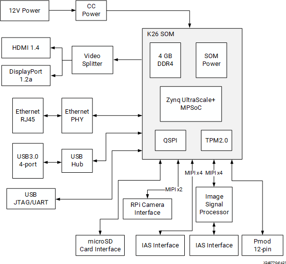
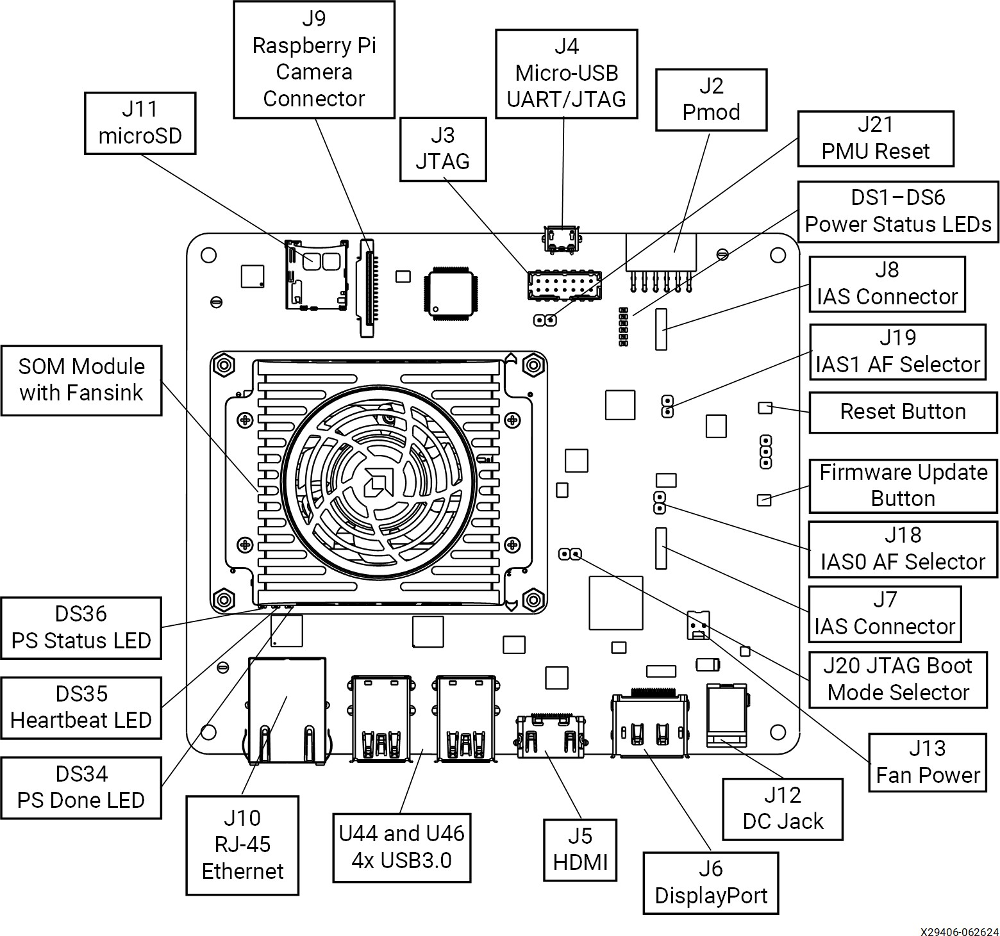
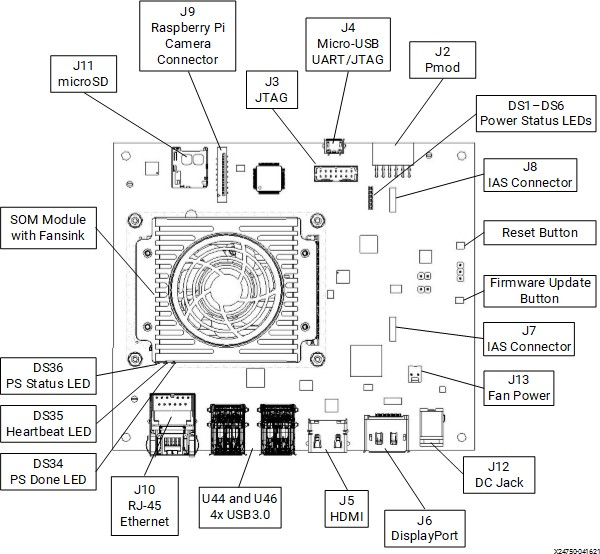
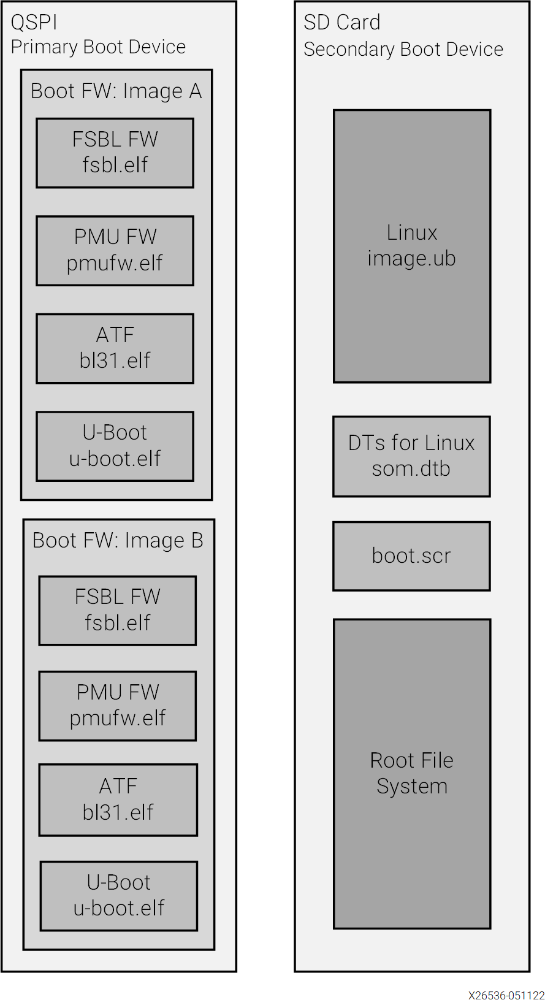
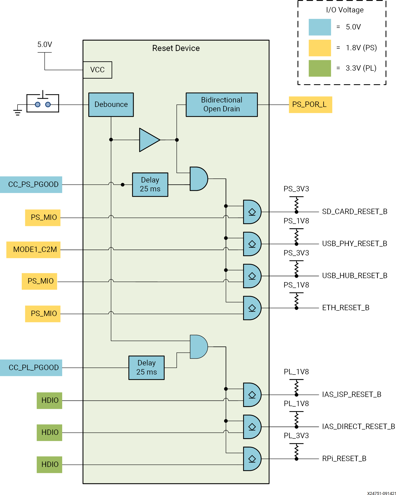

# Kria KV260 Vision AI Starter Kit User Guide (UG1089)

---

# TOC (목차)
## Summary (요약)
* What's in the Box? (박스 안에는 뭐가 들어 있나요?)
* Interfaces (인터페이스)
## Initial Setup (초기 설정)
* Powering the Starter Kit and Power Budgets (스타터 키트 전원 공급 및 전력 예산)
* Fan and Heat Sink (팬과 히트 싱크)
## Boot Devices and Firmware Overview (부팅 장치 및 펌웨어 개요)
* Primary Boot Device (주요 부팅 장치)
* Secondary Boot Device (보조 부팅 장치)
## Software Getting Started (소프트웨어 시작하기)
* Platform Management Utility (플랫폼 관리 유틸리티)
* Accelerated Applications (가속 응용 프로그램)
* Accelerated Application Package Selection (가속 응용 프로그램 패키지 선택)
* Supported Peripherals (지원되는 주변 장치)
## Xilinx Tools Integration (자일린스 도구 통합)
* Vitis Platforms (Vitis 플랫폼)
* Vivado Board Flow (Vivado 보드 플로우)
## Board Reset, Firmware Update, and Recovery (보드 리셋, 펌웨어 업데이트 및 복구)
* Board Reset (보드 리셋)
* Firmware Update (펌웨어 업데이트)
* Boot Image Recovery Tool (부팅 이미지 복구 도구)
* Boot Firmware A/B Update (부팅 펌웨어 A/B 업데이트)
## Additional Resources and Legal Notices (추가 자료 및 법적 고지)
* Finding Additional Documentation (추가 문서 찾기)
* Support Resources (지원 자료)
* References (참고 문헌)
* Revision History (개정 이력)
* Please Read: Important Legal Notices ( 꼭 읽어주세요: 중요한 법적 고지)

---

## Summary (요약)

The AMD Kria™ KV260 Vision AI Starter Kit is comprised of a non-production version of the K26 system-on-module (SOM), carrier card, and thermal solution. The SOM integrates core digital hardware components including an AMD Zynq™ UltraScale+™ MPSoC, run-time memory, non-volatile boot devices, an integrated power solution, and a security module. 
The vision-focused KV carrier card provides various application peripheral options including a variety of camera/sensor inputs, video display outputs, USB, SD card, and Ethernet physical interfaces. The thermal solution includes a heat sink, heat sink cover, and fan. The Kria KV260 Vision AI Starter  Kit is designed to provide customers a platform to evaluate their target applications and ultimately design their own carrier card with K26 SOMs. Key target applications include smart city, AI/ML computing, security, and future retail.

AMD Kria™ KV260 Vision AI 스타터 키트는 K26 시스템 온 모듈(SOM)의 비생산 버전, 캐리어 카드, 그리고 열 솔루션으로 구성되어 있어요. 이 SOM에는 AMD Zynq™ UltraScale+™ MPSoC, 런타임 메모리, 비휘발성 부트 장치, 통합 전원 솔루션, 그리고 보안 모듈 등 핵심 디지털 하드웨어가 들어 있어요. 
비전 중심의 KV 캐리어 카드는 다양한 카메라/센서 입력, 비디오 디스플레이 출력, USB, SD 카드, 이더넷 물리적 인터페이스 등 여러 애플리케이션 주변기기 옵션을 제공해요. 열 솔루션에는 히트 싱크, 히트 싱크 커버, 팬이 포함되어 있죠. Kria KV260 Vision AI 스타터 키트는 고객이 목표 애플리케이션을 평가하고 나중에 K26 SOM으로 자신의 캐리어 카드를 설계할 수 있는 플랫폼을 제공하도록 설계되었어요. 주요 목표 애플리케이션에는 스마트 시티, AI/ML 컴퓨팅, 보안, 미래형 리테일 등이 있어요.

<p align="center">
  
</p>

## What's in the Box? (상자 안에는 무엇이 들어있나요?)

The Kria KV260 Vision AI Starter Kit includes a K26 SOM, integrated thermal solution, and carrier card. The kit is only meant for SOM platform evaluation with the carrier card providing a variety of interfaces for integrating
different peripherals. The box also includes a Getting Started card that directs  you to the getting started web page and product page. Developer stickers are also included in the box. The KV260 Starter Kit does not include a power supply, SD card, peripherals, or additional accessories.

Kria KV260 Vision AI Starter Kit에는 K26 SOM, 통합 열 솔루션, 그리고 캐리어 카드가 포함되어 있습니다. 이 키트는 캐리어 카드를 통해 다양한 주변 장치를 연결할 수 있도록 SOM 플랫폼 평가용으로만 제공됩니다. 상자에는 시작 안내 카드도 들어있어 시작 웹페이지와 제품 페이지로 안내해 줍니다. 개발자용 스티커도 상자에 포함되어 있습니다. KV260 스타터 키트에는 전원 공급 장치, SD 카드, 주변 장치, 추가 액세서리는 포함되어 있지 않습니다.

However, this guide lists Power Adapters and Supported Peripherals you can purchase separately.

하지만, 이 가이드에는 별도로 구매할 수 있는 전원 어댑터와 지원되는 주변 장치가 나와 있습니다.

* Table: Summary of Box Contents *

| Line Item | Items | Quantity | 
|:------:|:------:|:------:|
| 1 | Starter Kit SOM with fansink thermal solution | 1 | 
| 2 | Starter kit carrier card | 1 | 
| 3 | Getting Started card | 1 | 
| 4 | Developer stickers | 1 | 


## Interfaces (인터페이스)

The following figure and table provide an overview of the physical connections, their designators, and relative position on the starter kit. The table  uses the following abbreviations to indicate if a specific designator is
located on the carrier card or on the SOM. There are two versions of the KV260 carrier card (rev. 1.0 and rev. 2.0). Some of the features are only available on the 2.0 version. For further details, refer to the schematics of
each version.

다음 그림과 표는 스타터 킷에서 물리적 연결, 설계자, 그리고 상대적 위치를 보여줍니다. 표에서는 특정 설계자가 캐리어 카드에 있는지 SOM에 있는지를 나타내기 위해 다음 약어를 사용합니다. KV260 캐리어 카드는 두 가지 버전(rev. 1.0과 rev. 2.0)이 있습니다. 일부 기능은 2.0 버전에서만 이용 가능합니다. 자세한 내용은 각 버전의 회로도를 참고하세요.

* CC = Device or interface is located on the carrier card (장치 또는 인터페이스가 캐리어 카드에 있음)
* SOM = Device or interface is located on the SOM (장치 또는 인터페이스가 SOM에 있음)

Figure: Interfaces and Connectors Rev. 2.0

<p align="center">
  
</p>

Figure: Interfaces and Connectors Rev. 1.0

<p align="center">
  
</p>

Table: Descriptions and Locations for both Rev 1.0 and Rev 2.0

| Location | Name | Present on Rev1.0 | Present on Rev 2.0 | Description | 
|:--------:|:--------:|:--------:|:--------:|--------|
| SOM DS34 | PS done LED | Y | Y | Lit indicates that the PS has successfully loaded a PL design. |
| SOM DS35 | Heartbeat LED | Y | Y | Periodic flashing green LED driven by the Zynq UltraScale+ MPSoC APU processor. | 
| SOM DS36 | PS status LED | Y|  Y | Status LED, when lit indicates a successful application load. | 
| CC DS1-DS6 | Power status LEDs | Y | Y | Indicates various power supply and power domain status.  Green LED indicates good status.  | 
| CC J2  | Pmod  | Y | Y | Digilent Pmod 2x6 expansion header  | 
| CC J3  | JTAG  | Y | Y | Direct JTAG interface, bypasses the FTDI device.  | 
| CC J20 | JTAG boot mode selection jumper | N | Y | When J20 is populated, it sets boot mode to JTAG instead of QSPI. By default, the header is not populated. |
| CC J4 | FTDI USB2.0 UART and JTAG | Y | Y | Integrated JTAG and device UART interface via USB2.0 |
| CC J6 | DisplayPort | Y | Y | DisplayPort video output |
| CC J5 | HDMI | Y | Y | HDMI™ video output | 
| CC J7 | IAS0 | Y | Y | OnSemi image access system (IAS) camera module interface supporting four MIPI lanes. Connects to OnSemi AP1302 ISP device sensor 0 interface. | 
| CC J18 | IAS0 AF selection jumper | N | Y| Default pin 1-2 is connected. When jumper connects the two pins, it enables the auto-focus (AF) power supply on IAS0. |
| CC J8 | IAS1 | Y | Y | OnSemi IAS camera module interface supporting four MIPI lanes. Connected directly to the Zynq UltraScale+ MPSoC HPA bank. |
| CC J19 | IAS1 AF selection jumper | N | Y | Header and capacitor and jumpers are not populated. When populated, it enables auto-focus power supply on IAS1. |
| CC J9 | RPi camera | Y | Y | Raspberry Pi camera module interface. 15-pin variant supporting two MIPI lanes directly connected directly to the Zynq UltraScale+ MPSoC HPA bank. | 
| CC J10 | Ethernet RJ45 jack | Y | Y | 1 Gb/s Ethernet interface |
| CC J11 | microSD card | Y | Y | microSD card boot device |
| CC J12 | 12V power input | Y |  Y | 12V power | input jack |
| CC J13 | Fan power | Y | Y | 12V SOM fan power interface |
| CC SW1 | Firmware update button | Y | Y | Push button used during the boot firmware update process. |
| CC SW2 | Reset button | Y | Y | Push button that resets the SOM via the device POR_B signal. | 
| CC J21 | PMU reset | N | Y | Default is for the jumper to not be populated. When connected and implemented by PMU firmware, it enables a PMU-commanded POR_B reset of the SOM. | 
| CC U44 | USB0 | Y | Y | Two USB3.0 or USB2.0 compatible connectors | 
| CC U46 | USB1 | Y | Y | Two USB3.0 or USB2.0 compatible connectors | 

# Initial Setup (초기 설정)

### Powering the Starter Kit and Power Budgets (스타터 키트 전원 및 전력 예산)

The AMD Kria™ KV260 Vision AI Starter Kit requires a 12V, 3A power supply adapter to power the kit.
AMD Kria™ KV260 Vision AI 스타터 키트는 키트를 작동시키기 위해 12V, 3A 전원 어댑터가 필요합니다.

> ✎ Note: The power supply adapter is not included in the KV260 Starter Kit. <br>
> ✎ 참고: 전원 어댑터는 KV260 스타터 키트에 포함되어 있지 않습니다. <br>
> The following table lists the suggested power supply adapter that must be purchased separately.
> 아래 표에는 별도로 구입해야 하는 권장 전원 어댑터가 나와 있습니다.

Table: Power Adapters to Purchase for the KV260 Starter Kit

| Vendor | Model | Description | 
|:-------:|:-------:|:-------:|
| CUI Inc. | SMI36-12-V-P6 | +12V, 3A DC adapter using a center-pin positive barrel connector (2.5 mm ID, 5.5 mm OD) | 

The power supply adapter barrel connector plugs into the DC jack (J12) to supply the +12V power source to KV260 Starter Kit.

### Powering the K26 SOM (K26 SOM 전원 공급)

The KV260 Starter Kit carrier card on-board regulator generates a 5V supply and provides power to other voltage regulators.
KV260 스타터 키트 캐리어 카드의 내장 레귤레이터가 5V 전원을 생성하고 다른 전압 레귤레이터에도 전원을 제공합니다.

The SOM power rail (VCC_SOM) is powered by the 5V supply.
SOM 전원 레일(VCC_SOM)은 5V 전원으로 구동됩니다.

Next, the SOM on-board power-on sequencing starts.
다음으로, SOM의 보드 내 전원 켜기 시퀀스가 시작됩니다.

The carrier card provides the programmable logic (PL) the VCCO voltage rails after the SOM asserts the VCCOEN_S_M2C and VCCOEN_PL_M2C signals
캐리어 카드는 SOM이 VCCOEN_S_M2C와 VCCOEN_PL_M2C 신호를 어설트한 후, 프로그래머블 로직(PL)에 VCCO 전원 레일을 제공합니다.

### Power Telemetry (전력 텔레메트리)

A power monitor device is available on the SOM power rail (VCC_SOM). You can access the total power consumed by the SOM module through the I2C bus and AMD provided utilities.
SOM 전원 레일(VCC_SOM)에서 전력 모니터 장치를 사용할 수 있습니다. I2C 버스와 AMD에서 제공하는 유틸리티를 통해 SOM 모듈이 소비하는 전체 전력을 확인할 수 있습니다.

### Powering Peripherals (주변기기 전원 공급)

The KV260 Starter Kit carrier card supplies power to the I/O peripherals as specified by the following interface specifications.
KV260 스타터 키트 캐리어 카드에서는 다음 인터페이스 사양에 따라 I/O 주변기기에 전원을 공급합니다.

### USB3.0

There are four USB3.0 interface ports available on the KV260 Starter Kit carrier card. Each port can deliver a 5V supply to the attached I/O peripherals with up to 900 mA per port. All ports are protected against an
over-current event through individual 900 mA power switches per port.
KV260 스타터 키트 캐리어 카드에는 총 4개의 USB3.0 인터페이스 포트가 있습니다. 각 포트는 연결된 I/O 주변기기에 최대 900 mA까지 5V 전원을 공급할 수 있습니다. 모든 포트는 개별 900 mA 전원 스위치를 통해 과전류 상황으로부터 보호됩니다.

> ✎ Note: The total current (across all four ports) is allocated at 2.1A.
> ✎ 참고: 총 전류(4개 포트 전체)는 2.1A로 할당됩니다.

### Pmod Connector (Pmod 커넥터)

The Pmod interface (from Digilent Inc.) is supported by the 3.3V, 100 mA capacity on the supply pin.
Pmod 인터페이스(Digilent Inc. 제공)는 공급 핀에서 3.3V, 100 mA 용량을 지원합니다.

## Raspberry Pi Camera Interface (라즈베리 파이 카메라 인터페이스)

The Raspberry Pi camera 15 pin interface connector is supported by the 3.3V supply voltage on the supply pin.
라즈베리 파이 카메라 15핀 인터페이스 커넥터는 공급 핀에서 3.3V 공급 전압을 지원합니다.

### IAS Module Connector (IAS 모듈 커넥터)

The SOM supports two IAS module connectors, as defined by the ON Semiconductor IAS module definition standard. The KV260 Starter Kit carrier card provides 2.75V, 1.8V, and 1.2V supply rails on specified power pins.
SOM은 ON Semiconductor IAS 모듈 정의 표준에 따라 두 개의 IAS 모듈 커넥터를 지원합니다. KV260 스타터 키트 캐리어 카드에서는 지정된 전원 핀에서 2.75V, 1.8V, 1.2V 전원 레일을 제공합니다.

## Fan and Heat Sink (팬과 히트 싱크)

The KV260 Starter Kit is built with an integrated active cooling solution (see Figure 2). The integrated fansink allows you to exercise the full 10W AMD Zynq™ UltraScale+™ MPSoC application power budget without any additional accessories.
KV260 스타터 키트는 통합 액티브 냉각 솔루션이 내장되어 있습니다(그림 2 참조). 통합 팬싱크 덕분에 추가 액세서리 없이도 전체 10W의 AMD Zynq™ UltraScale+™ MPSoC 애플리케이션 전력 예산을 충분히 활용할 수 있습니다.

Out of the box, the 12V fan should already be plugged into the starter kit. If it is not, be sure that the fan is plugged into the connector designated in Table 1. The fan connector is keyed to ensure proper orientation.
박스에서 꺼내면 12V 팬은 이미 스타터 키트에 연결되어 있어야 합니다. 연결되어 있지 않다면 팬이 표 1에 지정된 커넥터에 연결되어 있는지 확인하세요. 팬 커넥터는 올바른 방향으로 연결되도록 설계되어 있습니다.

By default, the fan runs at a constant speed. Variable fan speed control can be implemented through a FPGA based PWM fan controller. The fan gating signal is connected to a FPGA HD I/O bank pin for control. Consult the
corresponding KV260 Starter Kit carrier card schematic for specific pin assignment and AMD SOM source code repositories for an RTL implementation that can be integrated with your design.
기본적으로 팬은 일정한 속도로 작동합니다. 팬 속도 가변 제어는 FPGA 기반 PWM 팬 컨트롤러를 통해 구현할 수 있습니다. 팬 게이팅 신호는 제어를 위해 FPGA HD I/O 뱅크 핀에 연결됩니다. 특정 핀 할당은 KV260 스타터 키트 캐리어 카드 회로도를 참조하고, RTL 구현은 AMD SOM 소스 코드 저장소를 참고하여 디자인에 통합할 수 있습니다.

# Boot Devices and Firmware Overview (부트 장치 및 펌웨어 개요)

The AMD Kria™ KV260 Vision AI Starter Kit has a primary and secondary boot device that provides isolation of platform-specific boot firmware from the run-time operating system and application. This allows you to focus on developing and updating your application code within the application image without having to rebuild and flash boot firmware. The primary boot device is a QSPI memory located on the SOM and the secondary boot device is an SD card interface on the carrier card. By default, the KV260 Starter Kit carrier card sets the XCK26 boot mode to QSPI32. The SOM boots up to U-Boot using the QSPI contents and then U-Boot does a hand-off to the secondary boot device.

AMD Kria™ KV260 Vision AI 스타터 키트에는 기본 부트 장치와 보조 부트 장치가 있어 플랫폼별 부트 펌웨어를 런타임 운영체제 및 애플리케이션과 격리할 수 있습니다. 이를 통해 부트 펌웨어를 다시 빌드하고 플래시하지 않고도 애플리케이션 이미지 내에서 애플리케이션 코드를 개발하고 업데이트하는 데 집중할 수 있습니다. 기본 부트 장치는 SOM에 위치한 QSPI 메모리이고, 보조 부트 장치는 캐리어 카드의 SD 카드 인터페이스입니다. 기본적으로 KV260 스타터 키트 캐리어 카드는 XCK26 부트 모드를 QSPI32로 설정합니다. SOM은 QSPI 내용을 사용하여 U-Boot로 부팅한 후, U-Boot는 보조 부트 장치로 핸드오프합니다.

> ✎ Note: You must burn the SD card image and populate the SD card in the carrier card for the kit to successfully boot to Linux.
> ✎ 참고: 키트가 Linux로 성공적으로 부팅되려면 SD 카드 이미지를 구워 캐리어 카드에 SD 카드를 장착해야 합니다.

The overall boot device definition and firmware contents are outlined in the following figure.
전체 부트 장치 정의와 펌웨어 내용은 다음 그림에 나와 있습니다.

Figure: Boot Devices

<p align="center">
  
</p>

> ✎ Important: Production SOMs provide both QSPI and eMMC devices on the SOM PCB to support integrated primary and secondary boot configurations.
> ✎ 중요: 생산용 SOM은 통합된 1차 및 2차 부트 구성을 지원하기 위해 SOM PCB에 QSPI 및 eMMC 장치를 모두 제공합니다.

# Primary Boot Device (1차 부트 장치)

The primary boot device is a QSPI device located on the SOM. The necessary elements are packaged in an AMD Zynq™ UltraScale+™ MPSoC specific format  and file captured as BOOT.BIN. The BOOT.BIN file contains the board-specific boot firmware that consists of the following elements:
주 부팅 장치는 SOM에 위치한 QSPI 장치입니다. 필요한 요소들은 AMD Zynq™ UltraScale+™ MPSoC 전용 형식으로 패키징되어 BOOT.BIN 파일로 캡처됩니다. BOOT.BIN 파일에는 다음 요소들로 구성된 보드 전용 부팅 펌웨어가 포함되어 있습니다:

### FSBL (FSBL)
   * First-stage boot-loader firmware
   * 1단계 부트로더 펌웨어

### PMU
   * Platform management unit firmware
   * 플랫폼 관리 장치 펌웨어

### ATF
   * Arm® trusted firmware
   * Arm® 트러스트 펌웨어

### U-Boot
   * Second-stage boot loader
   * 2단계 부트로더

U-Boot provides the functionality for the hand-off between the primary boot device and the secondary boot device. It searches through a U-Boot defined prioritized list of secondary boot devices with priority given to the SD card interface.
U-Boot은 기본 부트 장치와 보조 부트 장치 간의 핸드오프 기능을 제공합니다. U-Boot에서 정의한 우선순위가 매겨진 보조 부트 장치 목록을 검색하며, SD 카드 인터페이스가 가장 높은 우선순위를 가집니다.

The primary boot device provides a redundant copy of boot firmware arranged in an A/B configuration. The A/B configuration provides a dynamic primary and secondary image operation with corresponding update mechanisms. On boot, the system automatically boots from the defined primary  image, and, if boot fails, it falls back to the previously known good boot image.
기본 부트 장치는 A/B 구성으로 배열된 부트 펌웨어의 중복 사본을 제공합니다. A/B 구성은 동적인 기본 및 보조 이미지 운영과 이에 따른 업데이트 메커니즘을 제공합니다. 부팅 시 시스템은 정의된 기본 이미지에서 자동으로 부팅하고, 부팅에 실패하면 이전에 정상적으로 부팅된 이미지로 되돌아갑니다.

## Secondary Boot Device (보조 부트 장치)

The secondary boot device on the KV260 Starter Kit is the SD card. It contains the operating system image and associated application files. The KV260 Starter Kit accelerated application references are built on the Linux operating system. The Getting Started web page provides a pre-built reference image that can be written to a microSD card for out-of-the-box functionality. SOM board support packages (BSPs) are also available if you want to customize your OS.
KV260 스타터 키트의 보조 부트 장치는 SD 카드입니다. 이 카드에는 운영 체제 이미지와 관련 애플리케이션 파일이 들어 있습니다. KV260 스타터 키트 가속화 애플리케이션 참조는 리눅스 운영 체제 기반으로 만들어졌습니다. 시작하기 웹 페이지에서는 미리 만들어진 참조 이미지를 제공하며, 이를 마이크로SD 카드에 기록하면 바로 사용할 수 있습니다. SOM 보드 지원 패키지(BSP)도 제공되므로 OS를 커스터마이징하고 싶다면 사용할 수 있습니다.

> ✎ Recommended: The SOM is designed to use SDHC standard microSD cards.
> ✎ 권장: SOM은 SDHC 표준 마이크로SD 카드를 사용하도록 설계되었습니다.

# Software Getting Started (소프트웨어 시작하기)

To get started with the KV260 Starter Kit, prior to powering, booting the board, and running your first application, you need to follow the instructions  on the Getting Started with Kria KV260 Vision AI Starter Kit pages to download and write the Xilinx SOM Starter Linux image to a microSD card. The webpage guides you to power on the KV260, boot Linux, and run a number of pre-built accelerated applications to start evaluation of the capabilities on the platform.
KV260 스타터 키트를 시작하려면, 보드에 전원을 켜고 부팅하며 첫 번째 애플리케이션을 실행하기 전에, Kria KV260 Vision AI 스타터 키트 시작하기 페이지의 지침을 따라 Xilinx SOM 스타터 리눅스 이미지를 microSD 카드에 다운로드하고 기록해야 합니다. 웹페이지는 KV260의 전원을 켜고 리눅스를 부팅하며, 미리 빌드된 가속화된 애플리케이션을 실행해 플랫폼의 기능을 평가할 수 있도록 안내합니다.

## Platform Management Utility (플랫폼 관리 유틸리티)

A platform management utility called xmutil is included in the SOM Linux image to help you configure and work with the SOM. Refer to the Kria SOM Wiki page for a list of xmutil functions and their descriptions.
SOM Linux 이미지에는 SOM을 구성하고 사용하기 쉽게 도와주는 xmutil이라는 플랫폼 관리 유틸리티가 포함되어 있어요. xmutil 기능과 설명 목록은 Kria SOM 위키 페이지를 참고하세요.

## Accelerated Applications (가속 애플리케이션)

The AMD SOM platforms are enabled with a number of accelerated applications that can be dynamically installed on the SOM platform. The SOM  starter Linux image is application agnostic and provides a set of utilities for pulling the hardware accelerated application examples from the SOM Linux package feeds.
AMD SOM 플랫폼에서는 여러 가속 애플리케이션을 동적으로 설치할 수 있어요. SOM 스타터 Linux 이미지는 특정 애플리케이션에 종속되지 않으며, SOM Linux 패키지 피드에서 하드웨어 가속 애플리케이션 예제를 가져올 수 있는 유틸리티들을 제공합니다.

Accelerated applications are software controllable, application-specific reference designs for AI developers, embedded developers, and system architects to customize and enhance the functionality through software control or updating the AI models. The following table outlines some featured accelerated applications available for the KV260 Starter Kit.
가속화 애플리케이션은 AI 개발자, 임베디드 개발자, 시스템 아키텍트를 위해 소프트웨어 제어를 통해 기능을 맞춤화하고 AI 모델을 업데이트하여 기능을 향상시킬 수 있는 소프트웨어 제어 가능 애플리케이션별 레퍼런스 디자인입니다. 다음 표는 KV260 스타터 키트에서 제공되는 일부 주요 가속화 애플리케이션을 보여줍니다.

Consider this list as a starting point because the SOM Getting Started web page contains the most up-to-date accelerated applications availability.
이 목록은 시작점으로 생각하세요. 최신 가속화 애플리케이션 정보는 SOM 시작하기 웹 페이지에서 확인할 수 있습니다.

Table: KV260 Accelerated Applications

| Name | Description | 
|:------:|:------:|
| Smart camera | Configurable camera/sensor input options with hardware accelerated ML inference with face detection and other models that can be dynamically loaded. Inference information is outputted to a monitor or network via RTSP. | 
| AI box-ReID | Multi-stream IP camera RTSP inputs with hardware accelerated ML inference models supporting face detection and re-identification (ReID) models. Outputs are displayed to monitor. | 
| Defect detection | Hardware accelerated machine vision application as applied in defect detection. | 

# Accelerated Application Package Selection (가속화된 애플리케이션 패키지 선택)

> ✎ Recommended: Public Ethernet connectivity is necessary to dynamically pull down the latest accelerated application designs.
> ✎ 추천: 최신 가속화된 애플리케이션 디자인을 동적으로 내려받으려면 공용 이더넷 연결이 필요합니다.

1. If you have not already verified Internet connectivity do so before proceeding via ping test or DNS lookup (e.g., nslookup).
1. 아직 인터넷 연결을 확인하지 않았다면, 진행하기 전에 ping 테스트나 DNS 조회(e.g., nslookup)를 통해 확인하세요.

2. The sudo xmutil getpkgs lists a series of package groups that apply to your platform. The package group naming convention is: packagegroup-kit_name-application_name . For example, the Smart Camera application for the KV260 platform has the following package group name packagegroup-kv260-smartcamera . You can install any number of matching accelerated applications to your platform by executing a DNF install for the chosen application package group. For
example, to install the smart camera application, run sudo dnf install packagegroup-kv260-smartcamera .
2. sudo xmutil getpkgs 명령어는 당신의 플랫폼에 적용되는 일련의 패키지 그룹을 보여줘요. 패키지 그룹 명명 규칙은 다음과 같아요: packagegroup-킷_이름-애플리케이션_이름. 예를 들어, KV260 플랫폼용 스마트 카메라 애플리케이션의 패키지 그룹 이름은 packagegroup-kv260-smartcamera예요. 선택한 애플리케이션 패키지 그룹을 DNF로 설치하면 원하는 만큼 동일한 가속 애플리케이션을 플랫폼에 설치할 수 있어요. 예를 들어, 스마트 카메라 애플리케이션을 설치하려면 sudo dnf install packagegroup-kv260-smartcamera를 실행하면 돼요.

> ✎ Note: You should only install package-groups that are compatible with your particular starter kit configuration.
> ✎ 참고: 사용 중인 스타터 키트 구성과 호환되는 패키지 그룹만 설치해야 해요.

3. For any applications installed on the local file system via the DNF install, the platform can now dynamically load and swap those applications. To see a list of the applications local to the system, execute sudo xmutil listapps . You can also see what applications are local by manually exploring the /opt/xilinx directory.
3. DNF 설치를 통해 로컬 파일 시스템에 설치된 애플리케이션의 경우, 이제 플랫폼에서 해당 애플리케이션을 동적으로 불러오고 교체할 수 있어요. 시스템에 로컬로 설치된 애플리케이션 목록을 보려면 sudo xmutil listapps 를 실행하면 됩니다. /opt/xilinx 디렉토리를 직접 탐색해서 로컬 애플리케이션을 확인할 수도 있어요.

4. By default, kv260-dp is loaded on boot. From the applications list, check for an active application loaded (active = 1 in the xmutil listapps output). If there is a loaded application, unload it by running the sudo xmutil unloadapp command to unload the current application before proceeding to the next step.
4. 기본적으로 kv260-dp는 부팅 시 로드됩니다. 애플리케이션 목록에서 활성 애플리케이션이 로드되어 있는지 확인하세요 (xmutil listapps 출력에서 active = 1). 만약 애플리케이션이 로드되어 있다면, 다음 단계로 진행하기 전에 sudo xmutil unloadapp 명령어를 실행해서 현재 애플리케이션을 언로드하세요.

5. From the application list, start the new application by running sudo xmutil loadapp application_name . The platform configuration is automatically handled and starts the application. 
5. 애플리케이션 목록에서 sudo xmutil loadapp application_name 명령어를 실행해서 새 애플리케이션을 시작하세요. 플랫폼 구성은 자동으로 처리되며 애플리케이션이 시작됩니다.

6. Applications with a Jupyter-based cockpit will start-up automatically. You need to point your web-browser to the associated IP address and port. The associated IP address and port information is printed to the UART at boot. To query your Jupyter lab server URL after the initial boot, run: sudo jupyter notebook list .
6. Jupyter 기반의 코콕핏을 가진 애플리케이션은 자동으로 시작됩니다. 웹 브라우저를 관련 IP 주소와 포트로 연결해야 합니다. 관련 IP 주소와 포트 정보는 부팅 시 UART에 출력됩니다. 초기 부팅 후 Jupyter 랩 서버 URL을 확인하려면 다음을 실행하세요: sudo jupyter notebook list.

# Supported Peripherals (지원되는 주변기기)

The following table outlines external peripherals that are tested with the corresponding accelerated applications. It is recommended that you use a peripheral from the list to ensure that you realize maximum platform performance.
다음 표는 해당 가속화된 애플리케이션과 함께 테스트된 외부 주변기기를 정리한 것입니다. 최대 플랫폼 성능을 발휘하려면 목록에 있는 주변기기를 사용하는 것이 좋습니다.

Table: Accelerated Application Peripherals


| Accelerated Application | Peripheral | Part Number | 
|:-----------:|:-----------:|:-----------:|
| Smart camera | IAS camera sensor ISP interface (J7)  | OnSemi AR1335 sensor module. Avnet part number: CAVBA-000A  | 
| Smart camera | USB camera   | Logitech BRIO  | 
| Smart camera | Audio Codec I2S PMOD (J2)  | Digilent PMOD SKU 410-379  | 
| AI-Box-ReID  | IP camera  | Amcrest IP8M-2493EW  | 

The following table outlines external peripherals that are functionally verified with the KV260 Starter Kit.
다음 표는 KV260 스타터 키트와 기능적으로 검증된 외부 주변기기를 보여줘요.

Table: KV260 Starter Kit Functionally Tested Peripherals

| Peripheral  |  Part Number  | 
|:-----------:|:-----------:|
| IAS camera sensor ISP interface (J7)  | OnSemi AR0144 | 
| IAS camera sensor ISP interface (J7)  | OnSemi AR1335 | 
| IAS camera sensor direct interface (J8) | OnSemi AR1335 | 
| RPi camera interface (J9) | Raspberry Pi camera module v2 | 

# Xilinx Tools Integration (자일링스 도구 통합)

The K26LTD SOM and KV260 Starter Kit are integrated with the AMD Vitis™ software development platform and AMD Vivado™ Design Suite for rapid development of your unique applications on the platform.
K26LTD SOM과 KV260 스타터 키트는 AMD Vitis™ 소프트웨어 개발 플랫폼과 AMD Vivado™ 디자인 스위트와 통합되어 있어 플랫폼에서 나만의 애플리케이션을 빠르게 개발할 수 있습니다.

## Vitis Platforms (Vitis 플랫폼)

Vitis base platforms are available in the kv260-vitis GitHub repository. For the KV260 Starter Kit, the following Vitis base platforms are available. Because additional KV260 base platforms are added and updated over time,
be sure to reference the repository for the most up to date list of platforms before starting your design work.
Vitis 베이스 플랫폼은 kv260-vitis GitHub 저장소에서 이용할 수 있습니다. KV260 스타터 키트의 경우, 다음과 같은 Vitis 베이스 플랫폼을 사용할 수 있습니다. 추가적인 KV260 베이스 플랫폼이 시간이 지나면서 계속 추가되고 업데이트되므로, 디자인 작업을 시작하기 전에 최신 플랫폼 목록을 저장소에서 확인하는 것이 좋습니다.

### kv260_ispMipiRx_vcu_DP

* Video capture using the IAS ISP MIPI interface for a AR1335 sensor module configuration
* AR1335 센서 모듈 설정을 위한 IAS ISP MIPI 인터페이스를 이용한 비디오 캡처

* Display using standard DisplayPort and/or HDMI™
* 표준 DisplayPort 및/또는 HDMI™를 통한 디스플레이

* Audio transmit and receive (I2S) via PMOD audio codec
* PMOD 오디오 코덱을 통해 오디오 송수신(I2S)

* Video codec unit (VCU) encode/decode and one stream encode buffer
* 비디오 코덱 유닛(VCU) 인코드/디코드와 하나의 스트림 인코드 버퍼

* Support for 4k30 and 1080p30 in NV12 video formats
* NV12 비디오 포맷에서 4k30 및 1080p30 지원

### kv260_vcuDecode_vmixDP

* VCU decode of four input streams
* Display using video mixer (VMIX) to DisplayPort and/or HDMI for 2x2 display configuration
* Resolution support for 1080p30 for each stream

### kv260_ispMipiRx_vmixDP

* Video capture using the IAS ISP MIPI interface for a AR0144 sensor module configuration
* VCU decoding of four streams
* Display using video mixer (VMIX) to DisplayPort and/or HDMI for 2x2 display configuration

Vitis base platforms are built within the context of a specific hardware target and the physical peripheral interfaces they enable.

```
starter-kit-name_interface1_interface2
```


For example, the kv260_ispMipiRx_vcu_DP base platform targets the KV260 Starter Kit and enables a MIPI receive interface to the ISP on the carrier card and a standard single video stream to the DisplayPort.

For additional information about the Vitis tools and Vitis base platform work flows, see the Embedded Design Development Using Vitis ([UG1701](https://docs.amd.com/access/sources/dita/map?isLatest=true&url=ug1701-vitis-accelerated-embedded&ft:locale=en-US)) and the Vitis Reference Guide ([UG1702](https://docs.amd.com/access/sources/dita/map?isLatest=true&url=ug1702-vitis-accelerated-reference&ft:locale=en-US)).

# Vivado Board Flow

The K26LTD SOM is enabled in the Vivado Design Suite through the Vivado Board Flow functionality. Vivado Board Flow enables a level of hardware abstraction that automatically configures peripherals fixed on the SOM card (e.g., DDR4), defines associated timing constraints, and presents the customizable physical I/O available on the SOM connector(s).

The Vivado SOM board model is available through the Vivado installation process as well as on the Vivado board file [GitHub](https://github.com/Xilinx/XilinxBoardStore/tree/HEAD/boards/Xilinx) repository. The following KV260 related Vivado board files are available.

### KV260 Starter Kit

* Configured K26 SOM with Vision Starter Kit companion card

### SM-K26-XCL2GC

* K26 commercial grade production SOM

### SM-K26-XCL2GI

* K26 industrial grade production SOM

The AMD SOM board flow infrastructure provides starter kit carrier card awareness through the Vivado tools companion card mechanism.

Automation for I/O connection and peripheral IP configuration when selecting a SOM and an associated carrier card, such as the KV260 Starter Kit,  is used to create a hardware configuration.

For additional information on using the Vivado tools and the Vivado board flow, refer to the Vivado Design Suite User Guide: System-Level Design Entry (UG895).

# Board Reset, Firmware Update, and Recovery

This section outlines the update and recovery mechanisms built into the KV260 Starter Kit. Two tools are provided for firmware updates. The first is a Linux based A/B update tool that supports remote and redundant firmware updates to the A/B firmware partitions of the QSPI device with custom  or AMD provided updates. The second tool is the Ethernet recovery tool that is intended to be used only when recovering a full platform to the original factory firmware.

## Board Reset

### Power-on Reset

1. The SOM reset signal (PS_POR_L) is held in reset until the CC_PS_PGOOD signal is asserted on the carrier card.

2. All the PS and PL I/O device reset signals on the carrier card are held in reset until 25 ms after the PS and PL power domain are powered up and stable.

3. You can perform a hard reset on the KV260 Starter Kit by pressing the reset button (CC SW2) or by commanding a reset through software.

The following figure shows the reset functions supported on the KV260 Starter Kit.

Figure: Device Reset

<p align="center">
  
</p>

## Firmware Update 

The firmware update button is the physical SW1/FWUEN push button located on the KV260 Starter Kit carrier card. The button is used to support two features:

1. To force the platform into a recovery mode application during power-on. The recovery application is described in the Boot Image Recovery Tool section of this document.

2. Security mechanism to prevent remote update of the boot firmware, without the user being physically present. 

## Boot Image Recovery Tool

The boot image recovery tool is a small application included in the AMD provided Starter Kit QSPI image. It provides a simple Ethernet-based interface  and application for updating the boot firmware if Linux is not functional. If Linux is functional, the recommendation is to update the boot firmware using the xmutil boot firmware update utilities. Refer to the Kria SOM Wiki page for details on how to use the boot image recovery tool.

## Boot Firmware A/B Update

As outlined in Boot Devices and Firmware Overview, the AMD starter kit and SOM provide two copies of the boot firmware in the QSPI device. This mechanism has a robust update infrastructure through a ping-pong methodology, where the last known good boot image is always kept available in the platform. The AMD starter kit Linux provides a utility for doing these updates entirely on-target. The steps for using the AMD SOM A/B update tool are documented in the Wiki page at: Boot FW Update Process.

# Additional Resources and Legal Notices

## Finding Additional Documentation

### Technical Information Portal

The AMD Technical Information Portal is an online tool that provides robust search and navigation for documentation using your web browser. To access  the Technical Information Portal, go to [https://docs.amd.com](https://docs.amd.com/)

### Documentation Navigator

Documentation Navigator (DocNav) is an installed tool that provides access to AMD Adaptive Computing documents, videos, and support resources, which you can filter and search to find information. To open DocNav:

* From the AMD Vivado™ IDE, select Help > Documentation and Tutorials.
* On Windows, click the Start button and select Xilinx Design Tools > DocNav.
* At the Linux command prompt, enter docnav.

> ✎ Note: For more information on DocNav, refer to the Documentation Navigator User Guide ([UG968](https://docs.amd.com/access/sources/dita/map?isLatest=true&ft:locale=en-US&url=Xilinx-Documentation-Navigator-User-Guide)).

## Design Hubs

AMD Design Hubs provide links to documentation organized by design tasks and other topics, which you can use to learn key concepts and address frequently asked questions. To access the Design Hubs:

* In DocNav, click the Design Hubs View tab.
* Go to the [Design Hubs](https://docs.amd.com/p/design-hubs) web page.

# Support Resources

For support resources such as Answers, Documentation, Downloads, and Forums, see [Support](https://adaptivesupport.amd.com/).

# References

These documents provide supplemental material useful with this guide:

1. [Kria SOM GitHub.io documentation](https://xilinx.github.io/kria-apps-docs)

2. Kria KV260 Vision AI Starter Kit Data Sheet ([DS986](https://docs.amd.com/go/en-US/ds986-kv260-starter-kit))

3. Kria K26 SOM Data Sheet ([DS987](https://docs.amd.com/go/en-US/ds987-k26-som))

4. Kria K26 SOM Thermal Design Guide ([UG1090](https://docs.amd.com/go/en-US/ug1090-k26-thermal-design))

5. Kria SOM Carrier Card Design Guide ([UG1091](https://docs.amd.com/go/en-US/ug1091-carrier-card-design))

6. Vitis Model Composer User Guide ([UG1483](https://docs.amd.com/access/sources/dita/map?isLatest=true&url=ug1483-model-composer-sys-gen-user-guide&ft:locale=en-US))

7. Vivado Design Suite User Guide: System-Level Design Entry ([UG895](https://docs.amd.com/access/sources/dita/map?isLatest=true&url=ug895-vivado-system-level-design-entry&ft:locale=en-US))

8. Embedded Design Development Using Vitis ([UG1701](https://docs.amd.com/access/sources/dita/map?isLatest=true&url=ug1701-vitis-accelerated-embedded&ft:locale=en-US))

9. Vitis Reference Guide ([UG1702](https://docs.amd.com/access/sources/dita/map?isLatest=true&url=ug1702-vitis-accelerated-reference&ft:locale=en-US))


* https://xilinx-wiki.atlassian.net/wiki/spaces/A/overview?homepageId=18844350


